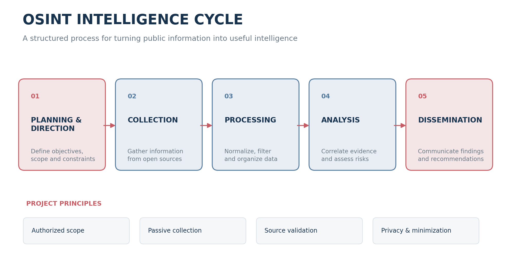
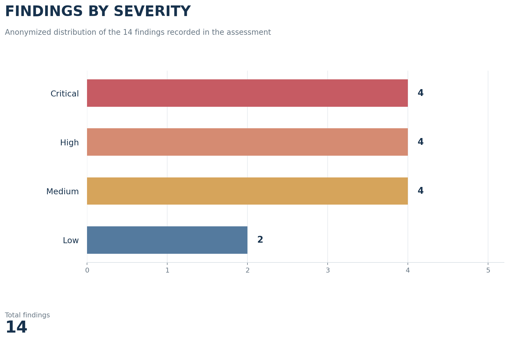
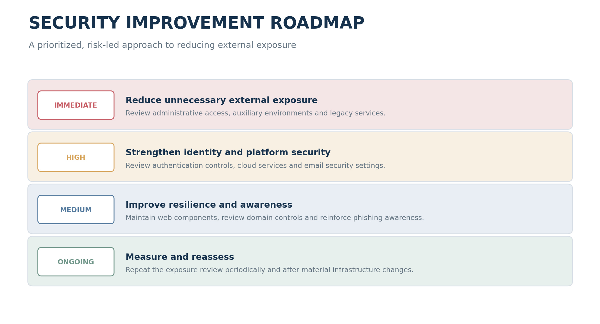

# OSINT Corporate Security Assessment
### Open Source Intelligence · Digital Footprint · Security Risk Assessment



## Project overview

This repository presents an anonymized, portfolio-oriented account of a collaborative corporate OSINT assessment. The work examined how publicly accessible information can be collected, assessed and converted into security-relevant intelligence.

The organization is intentionally unnamed. No original report, live indicators, personal information, account identifiers, hostnames, IP addresses, email addresses, or target-specific URLs are included.

## Objectives

- Review an organization's publicly visible digital footprint.
- Examine public corporate, social and technical information.
- Identify information that could increase exposure to phishing, impersonation or infrastructure-focused attacks.
- Classify observations by severity.
- Develop a prioritized set of defensive recommendations.

## Methodology

The assessment followed five intelligence-cycle phases:

1. **Planning and direction** — define objectives, scope, constraints and reporting requirements.
2. **Collection** — gather information from public sources using passive techniques.
3. **Processing** — organize, filter and normalize collected information.
4. **Analysis** — correlate observations, consider their significance and assess potential risks.
5. **Dissemination** — communicate findings and practical recommendations.

The assessment described in the source report was conducted within an authorized scope and relied on passive collection. This public repository does not reproduce operational details.

## Investigation areas

- **Corporate profile:** public organizational information and business context.
- **Social footprint:** public-facing professional and social presence, considered from a social-engineering risk perspective.
- **Technical footprint:** domain, DNS, certificate, hosting, mail and web-technology observations.
- **Risk assessment:** severity classification, plausible attack scenarios and defensive priorities.

## Anonymized results

The source assessment documented **14 findings**:

| Severity | Number of findings |
|---|---:|
| Critical | 4 |
| High | 4 |
| Medium | 4 |
| Low | 2 |
| **Total** | **14** |



The findings covered several broad themes, including infrastructure exposure, email configuration, auxiliary environments, domain and DNS security, public organizational information and document metadata. This summary intentionally omits target-specific indicators and reproduction details.

## Defensive improvement themes



The recommendations were grouped around:
- Reviewing unnecessary external exposure and administrative access.
- Strengthening identity, authentication and email security controls.
- Reviewing auxiliary environments and legacy services.
- Maintaining web components and domain-security configurations.
- Improving awareness of phishing and impersonation.
- Reassessing exposure periodically and after significant changes.

See [the recommendations](docs/recommendations.md) for the public-safe summary.

## Tools and sources

The original report records the use of tools and sources such as Shodan, Censys, WHOIS, DNS Dumpster, crt.sh, Wappalyzer, Hunter.io, TheHarvester, Maltego, ExifTool, Google search operators and public social platforms. See [tools and sources](tools/tools-and-sources.md).

This list describes the project workflow; it does not provide target-specific queries, commands, or indicators.

## Teamwork and learning

The project was completed by a five-member team. Work included research, collection, analysis, correlation, severity assessment and preparation of an executive report.

Key learning outcomes included:
- Applying the intelligence cycle to a corporate context.
- Assessing digital footprint and external exposure.
- Correlating information from different open sources.
- Distinguishing observations from assessed risk.
- Communicating findings through a structured report.
- Collaborating on a shared security deliverable.

## 📄 Project Documentation

A sanitized executive report is available for portfolio purposes.

[Download OSINT Portfolio Report](docs/OSINT_Portfolio_Edition_Eduardo_Martinez.pdf)

## Repository structure

```text
.
├── README.md
├── DISCLAIMER.md
├── docs/
│   ├── methodology.md
│   ├── executive-summary.md
│   └── recommendations.md
├── images/
│   ├── osint-workflow.png
│   ├── findings-overview.png
│   └── risk-assessment.png
└── tools/
    └── tools-and-sources.md
```

## Disclaimer

This repository is a sanitized educational and professional portfolio summary. It is not the original client report and must not be used to infer or identify the assessed organization. No exploitation or unauthorized access is described or endorsed. See [DISCLAIMER.md](DISCLAIMER.md).
